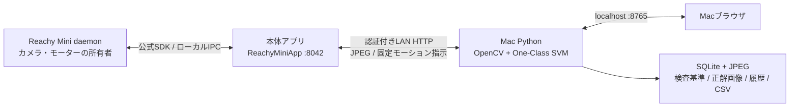

# システム構成と判定方式

[ドキュメント一覧](README.md)

登録した正解画像を基準に、MacでOne-Class SVMの学習・推論を行います。LEGOは動作確認用の対象例で、色や形を固定した判定ではありません。

## 構成

本体アプリだけがSDKのカメラ・モーター操作を行います。Macは本体の物理カメラを直接開きません。daemonがカメラを所有し、アプリはSDKのローカルIPCから読みます。本体はJPEGの縮小・圧縮のみ、学習とAI推論はMacで行います。画像・モデル・履歴をクラウドへ送信しません。APIキーは不要です。

公式CLI `reachy-mini-app-assistant create reachy_mini_ai_inspector ...` で生成した構成を使用しています。Python識別子・entry pointはアンダースコア、リポジトリ名は `reachy-mini-ai-inspector` です。

## AIと判定

- OpenCV：ROI切り出し、HSVによる対象抽出、モルフォロジー、輪郭・品質評価。
- 特徴：円環的に平滑化した18bin色分布、回転矩形の縦横比、占有面積、充填率、平均彩度・明度。
- 学習：scikit-learn `OneClassSVM(kernel="rbf", gamma=1.2, nu=0.08)` を正常品特徴でfit。
- 推論：各検査で `score_samples` と `decision_function` を実行し、結果を記録。
- スコア：`clip(1 - score_samples / 正常学習画像のscore_samples中央値, 0, 1)`。0ほど正常、1ほど異常。**確率・信頼度ではありません**。
- 品質が適切でAIスコア ≤ OK閾値、補助ルールとの矛盾なし → OK。
- 品質が適切でAIスコア ≥ NG閾値 → NG。色分布・投影形状を補助理由として表示。
- それ以外、未学習、対象なし・複数対象・ぼけ・範囲外 → REVIEW。

既定閾値はデモ動作確認用の初期値です。実物の評価用画像で調整し、調整後は別の検査画像で評価してください。AIスコアと補助ルールが食い違えばOKにせずREVIEWにします。

## 公式資料

- [SDK / AGENTS.md](https://github.com/pollen-robotics/reachy_mini/blob/main/AGENTS.md)
- [アプリ作成・公開](https://huggingface.co/docs/reachy_mini/SDK/apps)
- [メディア構成](https://huggingface.co/docs/reachy_mini/SDK/media-architecture)
- [Python SDK](https://huggingface.co/docs/reachy_mini/SDK/python-sdk)
- [REST API](https://huggingface.co/docs/reachy_mini/API/rest-api)

参照日：2026-10-21。公式main参照commit `24f74f03013ea12ba0d698e0c67545b2e59c6afc`、実行SDKは本体に合わせてPyPI `1.12.0`。
